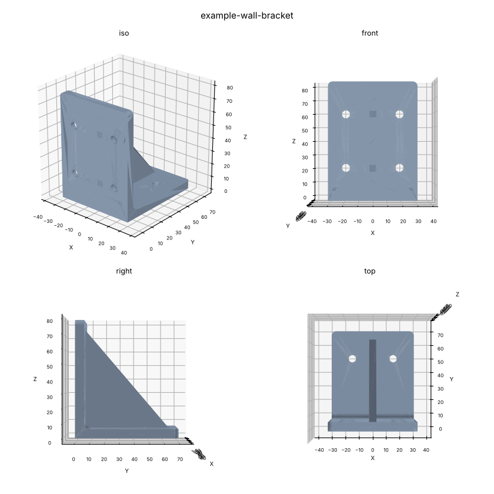

# CAD agent environment

A workspace in which an AI agent produces real CAD models from a description,
measurements and photos of an object. Geometry is written as Python with
[build123d](https://github.com/gumyr/build123d) on OpenCASCADE, executed in a
Docker container, and exported as STEP, STL and 3MF.

The point of the repository is repeatability: one command builds, measures,
renders and verifies a model, so an agent spends its effort on the geometry
rather than on re-inventing export and measurement scripts each session.

## Layout

```
.agents/        skills and tools the agent uses (tool-neutral)
  skills/       build123d-modeling, cad-project-workflow, dimensions-from-media
  tools/cad     the single entry point for every CAD operation
docker/         container definition: Python 3.12 + build123d 0.13 + OpenCASCADE
projects/       one directory per object: brief, spec, model, reference, output
tests/          smoke tests for the toolchain and the example project
.claude/skills  symlink to .agents/skills so Claude Code loads them
```

## Requirements

Docker, and nothing else. The first `cad` invocation builds the image, which
takes a few minutes and about 2 GB (OpenCASCADE is large). Afterwards every
command runs in a throwaway container with the repository bind-mounted at
`/work` and **no network access**.

To work without Docker, install `build123d`, `matplotlib` and
`PyYAML` into a Python 3.11-3.14 environment and set `CAD_LOCAL=1`.

## Usage

```bash
.agents/tools/cad doctor                 # check the toolchain
.agents/tools/cad new phone-stand        # scaffold projects/phone-stand/
#   fill in README.md (brief + dimensions), spec.yaml (checks), model.py
.agents/tools/cad build phone-stand      # export + measure + render + check
```

`cad build` prints a summary and writes everything to
`projects/<name>/output/`:

```
built example-wall-bracket in 1.9s
  wall-bracket:
    bbox      60 x 70 x 80 mm
    volume    60329.8 mm^3   mass 74.809 g
    com       (0, 19.7648, 24.0877) mm
    topology  solids=1, shells=1, faces=31, edges=75, vertices=50
    valid=True manifold=True
  ...
  checks: PASS (6/6)
```

Other commands: `list`, `measure`, `preview`, `views` (2D SVG/DXF with hidden
lines), `check`, `run`, `formats`. Add `--json` for machine-readable output.
Full reference: [`.agents/README.md`](.agents/README.md).

## How a project is organised

Each object gets a directory under `projects/` holding the brief and
dimension table (`README.md`), the machine-checkable acceptance criteria
(`spec.yaml`), the parametric model (`model.py`) and the user's photos
(`reference/`). Generated files land in `output/` and are not committed.

`spec.yaml` is what makes revision cheap - the requirements are checkable:

```yaml
checks:
  tolerance_mm: 0.1
  bbox_mm: {x: 60, y: 70, z: 80}
  volume_mm3: [57000, 64000]
  watertight: true
  solids: 1
```

`cad check` exits non-zero when the model stops matching the brief.

## Worked example

```bash
make example
```

builds [`projects/example-wall-bracket/`](projects/example-wall-bracket/), a
parametric shelf bracket with counterbored M5 fixings and a gusset, and
renders it to `output/preview/example-wall-bracket_views.png`:



## Tests

```bash
make test
```
